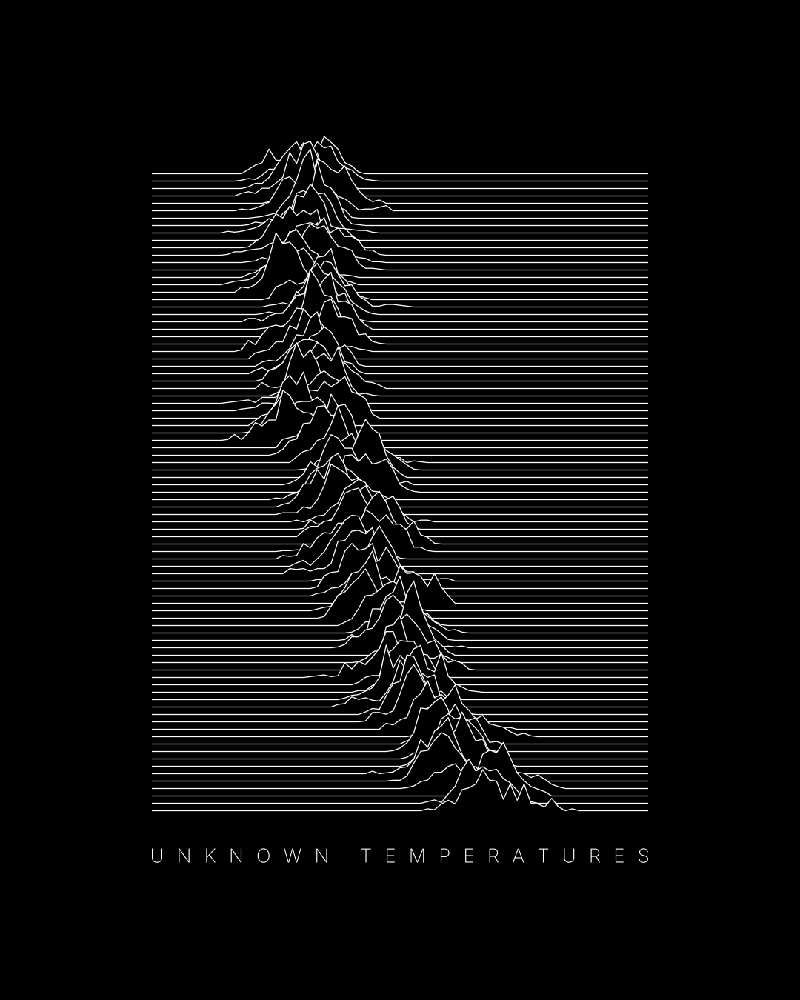

# Unknown Temperatures



Every day since 1940, drawn as a stack of pulses. There is one line per year, with 1940
at the top and the current year in front. Each pulse shows how that year's days were
spread over global temperature, warmer to the right, so the pulses drift right as the
planet warms.

The data is the same as in the celsius.earth chart "Every year's days". The form follows
the stacked plot of pulsar CP 1919 on the sleeve of Joy Division's *Unknown Pleasures*.

## Run

```bash
pip install numpy matplotlib
python unknown_temperatures.py
```

| Option | Effect |
| --- | --- |
| `--bin 0.08` | Bin width in °C. Wider bins give coarser pulses. The default is 0.05. |
| `--refresh` | Download the latest days before drawing. |
| `--scale 2` | 2160 × 2700 pixels instead of 1080 × 1350. |
| `--out path` | Output path without extension. |

The script writes three files next to itself:

| File | Contents |
| --- | --- |
| `unknown_temperatures.png` | The artwork. |
| `unknown_temperatures.svg` | The same as vectors, for print. |
| `unknown_temperatures.csv` | The resampled data: days per year (rows) and temperature bin (columns, named by the bin centre in °C). |

Layout, peak height, title and font are constants at the top of the script. The title is
set in Inter Light when it is installed.

## How it works

1. **Resample.** Each year's days are counted into temperature bins shared by all years.
   Nothing is smoothed, so a year becomes a jagged pulse instead of a bell curve.
2. **Render.** A line's height is the share of that year's days in each bin, which keeps
   the unfinished current year on the same scale as the others. A line is flat wherever
   its year had no days, and each line hides the ones behind it.

## Data

ERA5 daily global-mean 2 m air temperature from the Copernicus Climate Change Service
(C3S) / ECMWF:
<https://sites.ecmwf.int/data/climatepulse/data/series/era5_daily_series_2t_global.csv>

The file gives anomalies against 1991–2020. The script adds 0.88 °C, the C3S estimate of
how much warmer that period is than 1850–1900.

The committed image and CSV cover 31,737 days, to 2026-11-21. The downloaded series is
cached in `data/`, which is not committed.

Contains modified Copernicus Climate Change Service information 2026.
